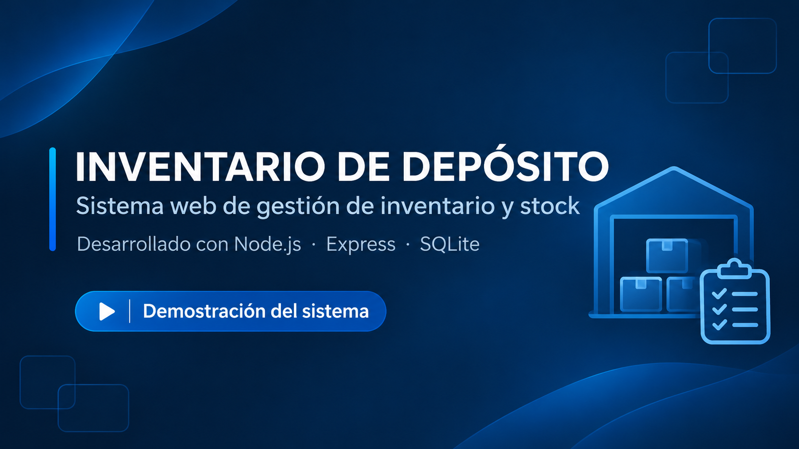

# Inventario de Depósito

En donde trabajo encontre una posibilidad de mejora para registro de hardware y cree una
aplicación web para la gestión y administración de inventario, desarrollada con Node.js, Express y SQLite.

## Descripción

Inventario de Depósito permite centralizar el control de artículos, existencias y movimientos de un depósito mediante una interfaz web.

El objetivo del proyecto es facilitar la organización de los recursos y mejorar el seguimiento del inventario.

## Funcionalidades

- Registro y administración de artículos.
- Consulta y control de stock.
- Gestión de movimientos de inventario.
- Inicio de sesión de usuarios.
- Administración de usuarios y permisos.
- Interfaz web adaptable a diferentes dispositivos.

## Tecnologías utilizadas

- Node.js
- Express.js
- SQLite
- JavaScript
- HTML5
- CSS3
- Git y GitHub

## Estructura del proyecto

- `server.js`: servidor principal.
- `database.js`: conexión y operaciones con la base de datos.
- `public/`: interfaz web y recursos estáticos.
- `package.json`: dependencias y configuración de Node.js.
- `.gitignore`: archivos excluidos del repositorio.

## Instalación

### Requisitos

- Node.js y npm instalados.
- Git instalado.
- Windows con PowerShell para seguir estos comandos.

### 1. Clonar el repositorio

```powershell
git clone https://github.com/FJFajardoPuentes/inventario-deposito.git
```

### 2. Entrar a la carpeta

```powershell
cd inventario-deposito
```

### 3. Instalar las dependencias

```powershell
npm ci
```

### 4. Configurar las variables de entorno

```powershell
Copy-Item .env.example .env
```

Editar el archivo .env con la configuración correspondiente.

### 5. Iniciar la aplicación

```powershell
npm start
```

Abrir en el navegador la dirección local y el puerto que indique el servidor.

### Base de datos

El repositorio incluye inventario.db con datos ficticios de demostración.

No es necesario crear manualmente la base de datos para probar la aplicación.

## Estado del proyecto

En desarrollo y mejora continua.

## Autor

FJFajardoPuentes (facu101@hotmail.com)

## 🎬 Demostración en video

Conocé las principales funcionalidades de Inventario de Depósito mediante una demostración completa del sistema.

[](https://youtu.be/57XvWfUmBj8)

**Contenido del video:**

- Inicio de sesión
- Alta y baja de artículos
- Consultas de productos
- Control de stock
- Historial de movimientos

Haz clic en la imagen para reproducir la demostración.


## Repositorio

https://github.com/FJFajardoPuentes/inventario-deposito
